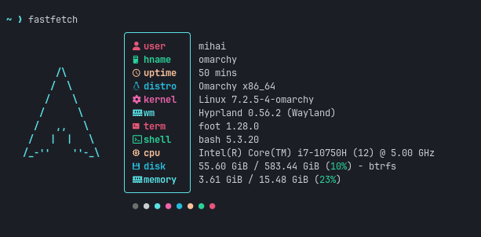
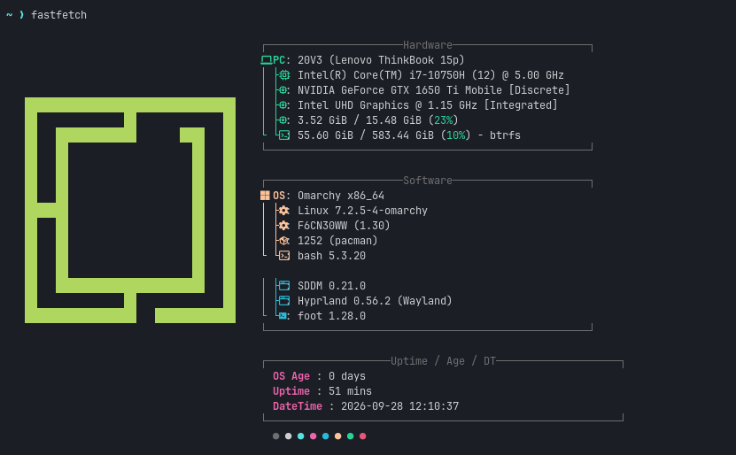

# Dotfiles

Personal Linux configuration, one program per subdirectory.

## What's here

| Config | What it is |
| --- | --- |
| [Hyprland](Hyprland/) | Hyprland configuration and keybindings, written in Lua |
| [Niri](Niri/) | Niri compositor config, Noctalia shell settings, plugins, and universal clipboard |
| [Fastfetch](Fastfetch/) | Two `fastfetch` layouts with a script to pick and install one |

## Installing

```sh
git clone https://github.com/nightdevil00/Dotfiles.git
cd Dotfiles
./install.sh
```

`install.sh` opens a picker:

1. Hyprland
2. Niri + Noctalia
3. Fastfetch
4. Hyprland + Niri/Noctalia

You can also pick a target directly:

```sh
./install.sh hyprland
./install.sh niri
./install.sh fastfetch
./install.sh all
```

Every installer backs up the existing destination to a timestamped path before
overwriting it, so they are safe to run on an already configured machine:

```sh
./install.sh niri --all --dry-run    # show what would change, write nothing
./install.sh niri --all --force      # skip the backup
```

Re-running is safe: identical files are reported as unchanged and skipped.
The Niri installer also accepts component flags such as `--niri`,
`--noctalia`, `--clipboard`, `--plugins`, and `--all`; see
[Niri/README.md](Niri/README.md).

After installing, reload the running session:

```sh
hyprctl reload                     # Hyprland
niri msg action load-config-file   # Niri
noctalia msg config-reload         # Noctalia settings
```

The installers do the reload automatically when the corresponding service is
running, unless `--no-reload` is passed to the Niri installer.

## Hyprland

| File | Purpose |
| --- | --- |
| `hyprland.lua` | Entry point; loads the rest and decides what to source from where |
| `bindings.lua` | Personal keybindings and overrides (e.g. headphone Play/Pause mapped to one-way `media.play` / `media.pause` actions) |
| `autostart.lua` | Extra autostart processes; ships empty with a commented `o.launch_on_start("my-service")` to copy |
| `monitors.lua` | Monitor, mode, scale, position and transform |
| `input.lua` | Keyboard, touchpad, mouse and stylus settings |
| `looknfeel.lua` | Cursor, focus, border, opacity and misc feel |
| `oma-cast.lua` | `oma-cast` launcher keybinding (Alt+Space), written by `oma-cast setup hyprland` |
| `xdph.conf`, `hyprsunset.conf` | XWayland and blue-light / night light configuration |

The config is written against [hyprland-lua](https://github.com/hyprwm/hyprland-lua)
and layers over an [Omarchy](https://omarchy.org/) base install.
`.luarc.json` is editor metadata for Lua tooling, not part of the config.

## Niri + Noctalia

The Niri package mirrors the real destination layout, so the installer only has
to map `config/` to `~/.config/` and `local/` to `~/.local/`.

| File | Installed to | Purpose |
| --- | --- | --- |
| `config/niri/` | `~/.config/niri/` | `config.kdl`, split `cfg/*.kdl`, and Noctalia's generated `noctalia.kdl` |
| `config/noctalia/config.toml` | `~/.config/noctalia/config.toml` | Noctalia boot config (polkit agent) |
| `local/state/noctalia/settings.toml` | `~/.local/state/noctalia/settings.toml` | Active Noctalia settings: bar, theme, wallpaper, plugins, clipboard |
| `local/bin/niri-universal-clipboard` | `~/.local/bin/niri-universal-clipboard` | Omarchy-style `Super+A/C/X/V` helper |
| `local/state/noctalia/plugins/materialized/community/` | same path under `~/.local/state/` | DropWall, Niri Animations, and Spotify Media plugins |

The clipboard bindings are:

| Key | Action |
| --- | --- |
| `Super+A` | Select all |
| `Super+C` | Copy (`Ctrl+Shift+C` in terminals) |
| `Super+X` | Cut |
| `Super+V` | Paste (`Ctrl+Shift+V` in terminals) |
| `Super+Ctrl+V` | Noctalia clipboard history |

`Super+C` used to be `center-column`; that moved to `Super+Shift+C`.
Clipboard history needs Noctalia, and the helper needs `wtype` and `jq`:

```sh
sudo pacman -S --needed niri noctalia wtype jq
```

Private state such as clipboard history, notification history, launcher usage,
wallpaper images, and Noctalia's download caches is intentionally not copied.
See [Niri/README.md](Niri/README.md) for the full component list and
machine-specific notes.

## Fastfetch

Two `fastfetch` layouts and a script to pick between them.

| File | Purpose |
| --- | --- |
| `config1.jsonc` | Minimal layout — one bordered column beside a small ASCII logo, every label its own colour |
| `config2.jsonc` | Sectioned layout — Hardware / Software / Uptime-Age-DateTime panels, one key colour per section |
| `config1.png`, `config2.png` | Screenshots of each layout |
| `install.sh` | Picks a config and copies it to `~/.config/fastfetch/config.jsonc` |

```sh
cd Dotfiles/Fastfetch
./install.sh          # pick 1 or 2 from the menu
./install.sh 2        # or pass the number directly
```

It creates `~/.config/fastfetch/` if it doesn't exist, copies the chosen config
to `config.jsonc`, and backs up any existing config to a timestamped
`config.jsonc.bak.*` first. Then run `fastfetch` to try it out.

Both layouts use Nerd Font icons, so your terminal font needs to be a Nerd Font
— JetBrainsMono Nerd Font, MesloLGS NF, Iosevka Term and similar.





`config2` is based on [a config by u/aayush-le](https://www.reddit.com/r/GarudaLinux/comments/1dcq0dl/making_fastfetch_more_beautiful_linux/).
More detail, including what to tweak when editing, is in
[Fastfetch/README.md](Fastfetch/README.md).
